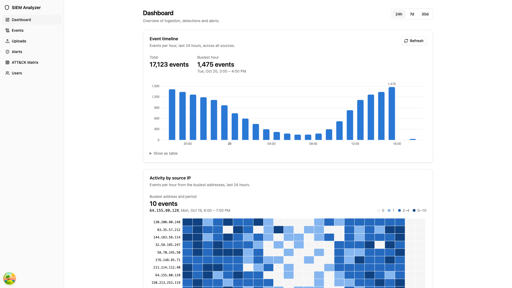
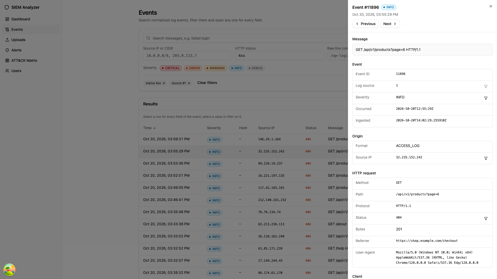
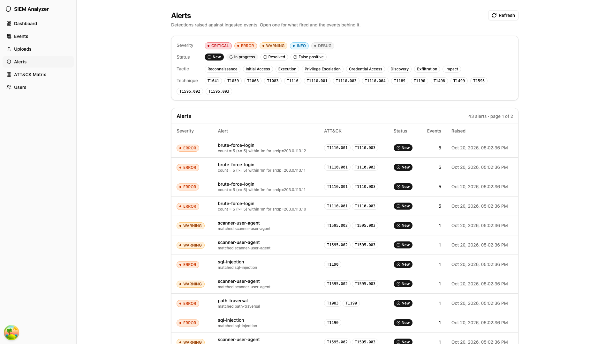
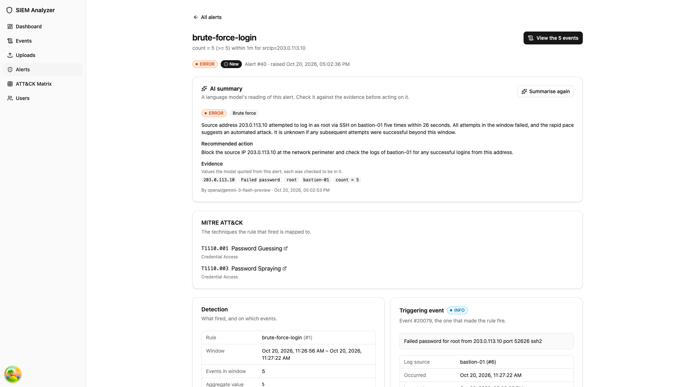
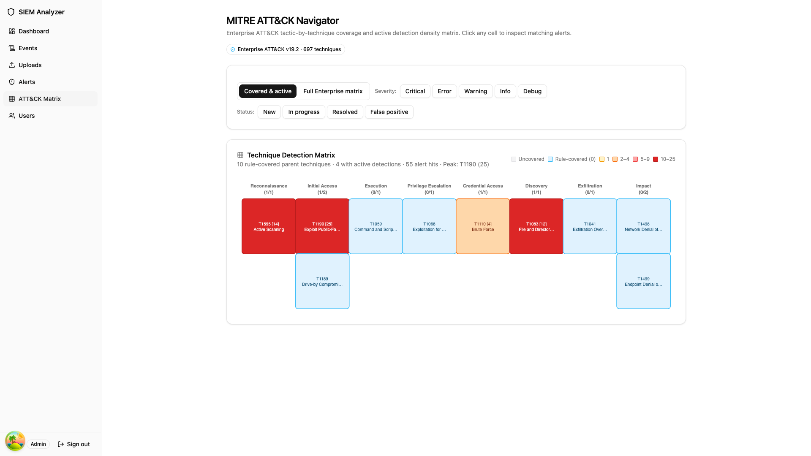
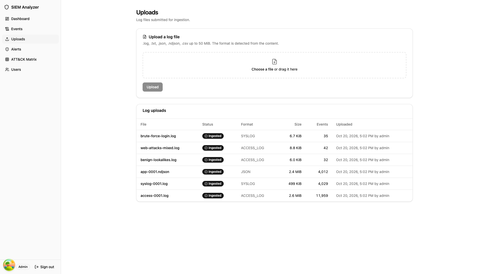
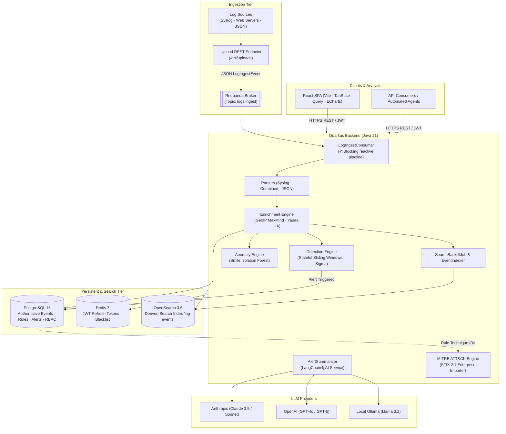

# AI-SIEM Logs Analyzer

[](https://adoptium.net/)
[](https://quarkus.io/)
[](https://react.dev/)
[](https://www.typescriptlang.org/)
[](https://www.postgresql.org/)
[](https://opensearch.org/)
[](https://redpanda.com/)
[](https://redis.io/)

A modern, cloud-native **Security Information and Event Management (SIEM)** and log analysis platform. It ingests heterogeneous logs via Kafka/Redpanda, normalizes and enriches them in real time with GeoIP and User-Agent intelligence, indexes events into OpenSearch, evaluates events against stateful detection rules and Isolation Forest ML anomaly models, maps threats to the **MITRE ATT&CK®** framework, and provides automated **LLM-assisted incident triage** (LangChain4j with Claude, GPT, or Ollama) through an analyst web dashboard.

---

## Table of Contents

- [Visual Showcase & Demo](#visual-showcase--demo)
  - [GIF Demo Walkthrough](#gif-demo-walkthrough)
  - [Core Interface Screenshots](#core-interface-screenshots)
- [Credentials & Authentication](#credentials--authentication)
  - [Default Roles & Permissions](#default-roles--permissions)
  - [Initial Administrator Bootstrap](#initial-administrator-bootstrap)
  - [Provisioning Analyst & Viewer Accounts](#provisioning-analyst--viewer-accounts)
- [Running Instructions (Instrucțiuni de rulat)](#running-instructions-instrucțiuni-de-rulat)
  - [Prerequisites](#prerequisites)
  - [Method 1: Complete Containerized Stack (Recommended for Quick Demo)](#method-1-complete-containerized-stack-recommended-for-quick-demo)
  - [Method 2: Local Development Mode (Live Reload)](#method-2-local-development-mode-live-reload)
  - [Generating Synthetic Logs & Attack Scenarios](#generating-synthetic-logs--attack-scenarios)
  - [Service Ports & URL Matrix](#service-ports--url-matrix)
  - [Makefile Command Reference](#makefile-command-reference)
  - [Testing, Code Quality & CI Verification](#testing-code-quality--ci-verification)
- [System Architecture (Arhitectură)](#system-architecture-arhitectură)
  - [High-Level Architecture Diagram](#high-level-architecture-diagram)
  - [Ingestion & Normalization Pipeline](#1-ingestion--normalization-pipeline)
  - [Real-Time Context Enrichment](#2-real-time-context-enrichment)
  - [Multi-Tier Detection Engine](#3-multi-tier-detection-engine)
  - [Threat Intel & MITRE ATT&CK Mapping](#4-threat-intel--mitre-attck-mapping)
  - [Derived OpenSearch Search Engine](#5-derived-opensearch-search-engine)
  - [AI Agentic Triage & Incident Analysis](#6-ai-agentic-triage--incident-analysis)
  - [Security, Cryptography & Storage](#7-security-cryptography--storage)
- [Documentation Index](#documentation-index)

---

## Visual Showcase & Demo

### GIF Demo Walkthrough

The walkthrough below demonstrates an end-to-end security incident lifecycle: uploading a multi-stage attack log, real-time ingestion, automatic detection trigger (SQLi and Brute-force), MITRE ATT&CK matrix overlay, and instant LangChain4j AI triage recommendation:


_Note: Visual assets are located in [docs/screenshots/](docs/screenshots/)._

### Core Interface Screenshots

|                                              Security Analyst Dashboard                                              |                                       Real-Time Log Explorer & Search                                        |
| :------------------------------------------------------------------------------------------------------------------: | :----------------------------------------------------------------------------------------------------------: |
|                                                         |                                                       |
| _High-throughput event volume, ECharts temporal activity heatmap, HTTP status & error distribution, cluster health._ | _Sub-second OpenSearch log query engine, facet aggregations, time-slice scoping, and parsed metadata sheet._ |

|                                     Alert Queue & Sliding-Window Triage                                      |                                            LangChain4j AI Incident Investigation                                             |
| :----------------------------------------------------------------------------------------------------------: | :--------------------------------------------------------------------------------------------------------------------------: |
|                                                        |                                                                   |
| _Active alert queue grouped by severity and lifecycle (`NEW`, `IN_PROGRESS`, `RESOLVED`, `FALSE_POSITIVE`)._ | _One-click AI summary: root cause hypothesis, verified attack evidence, severity classification, and actionable mitigation._ |

|                                            MITRE ATT&CK® Enterprise Matrix                                             |                                          Multi-Format Log Ingestion                                          |
| :--------------------------------------------------------------------------------------------------------------------: | :----------------------------------------------------------------------------------------------------------: |
|                                                              |                                                   |
| _Heatmap of active detections mapped directly to ATT&CK tactics (Initial Access, Credential Access, Discovery, etc.)._ | _Drag-and-drop log uploader supporting Syslog (RFC 5424/3164), Web Access Logs, JSON Lines, and plain text._ |

---

## Credentials & Authentication

The platform enforces a zero-trust, stateless authentication model:

- **Passwords:** Hashed with **Argon2id** (OWASP recommendation: 19 MiB RAM, 2 iterations, 1 parallelism thread).
- **Access Tokens:** Signed **SmallRye JWT** (RS256 keypair).
- **Refresh Tokens:** Opaque, single-use UUIDs persisted in **Redis** with atomic rotation and automatic replay detection.
- **Authorization:** Strict role-based access control (`@RolesAllowed`) across all REST endpoints.

### Default Roles & Permissions

| Role      | Hierarchy / Capabilities                                                                                                                                                | Typical Persona                 |
| --------- | ----------------------------------------------------------------------------------------------------------------------------------------------------------------------- | ------------------------------- |
| `ADMIN`   | Full administrative control: manage user accounts, assign roles, import STIX ATT&CK bundles, configure detection rules, ingest logs, triage alerts.                     | SIEM Administrator, SecOps Lead |
| `ANALYST` | Operational triage: search events, inspect alert windows, trigger AI incident summaries, update alert lifecycle statuses (`IN_PROGRESS`, `RESOLVED`, `FALSE_POSITIVE`). | SOC Analyst L1/L2               |
| `VIEWER`  | Read-only visibility: view executive dashboards, search historical logs, view raised alerts and MITRE heatmaps.                                                         | Auditor, IT Manager             |

### Initial Administrator Bootstrap

By security design (`V2__users.sql`), the default `admin` account is seeded with a non-matching password hash (`!`), guaranteeing that an unconfigured deployment cannot be compromised with a factory credential.

To initialize the `admin` password on first start, choose either option:

#### Option A: Automatic Startup Bootstrap (Recommended)

Pass the `APP_AUTH_BOOTSTRAP_PASSWORD` environment variable when starting the backend:

```bash
cd backend
APP_AUTH_BOOTSTRAP_PASSWORD='SuperSecretAdminPassword123!' ./mvnw quarkus:dev
```

#### Option B: Via Direct Setup API

Execute an administrative password reset using `curl`:

```bash
curl -s -X PUT http://localhost:8080/api/users/1/password \
  -H 'Content-Type: application/json' \
  -d '{"password": "SuperSecretAdminPassword123!"}'
```

#### Sign In & Obtain JWT

```bash
curl -s -X POST http://localhost:8080/api/auth/login \
  -H 'Content-Type: application/json' \
  -d '{"username": "admin", "password": "SuperSecretAdminPassword123!"}'
```

Response:

```json
{
  "accessToken": "eyJhbGciOiJSUzI1NiIs...",
  "refreshToken": "4a71d02e-9d21-4f81-806f-4220b3e6c0ea",
  "expiresIn": 900,
  "user": {
    "id": 1,
    "username": "admin",
    "roles": ["ADMIN"]
  }
}
```

### Provisioning Analyst & Viewer Accounts

Once authenticated as an administrator, create SOC operator accounts via the UI (`/users`) or via the REST API:

```bash
# Create an Analyst account
curl -s -X POST http://localhost:8080/api/users \
  -H "Authorization: Bearer $ADMIN_JWT" \
  -H "Content-Type: application/json" \
  -d '{
    "username": "analyst_bob",
    "email": "bob@security.internal",
    "password": "AnalystPassword456!",
    "roles": ["ANALYST"]
  }'

# Create a Viewer account
curl -s -X POST http://localhost:8080/api/users \
  -H "Authorization: Bearer $ADMIN_JWT" \
  -H "Content-Type: application/json" \
  -d '{
    "username": "auditor_alice",
    "email": "alice@audit.internal",
    "password": "AuditorPassword789!",
    "roles": ["VIEWER"]
  }'
```

---

## Running Instructions (Instrucțiuni de rulat)

### Prerequisites

| Tool                 | Minimum Version    | Note                                           |
| -------------------- | ------------------ | ---------------------------------------------- |
| **Docker & Compose** | 24.0+ (Compose v2) | Required for local dependencies and containers |
| **JDK (Java)**       | 21 (LTS)           | Eclipse Temurin 21 recommended                 |
| **Node.js & pnpm**   | Node 20+, pnpm 9+  | Required for the React SPA                     |
| **Make**             | 3.81+              | Automation wrapper across all lifecycles       |

---

### Method 1: Complete Containerized Stack (Recommended for Quick Demo)

To run the entire platform (PostgreSQL, Redis, Redpanda, OpenSearch, Quarkus Backend, and React Frontend) without installing Java or Node on the host:

```bash
# 1. Initialize environment file
cp docker/.env.example docker/.env

# 2. Build backend & frontend container images and start the full stack
make up-app
```

The command automatically waits until all service healthchecks report healthy:

- **Frontend Dashboard:** [http://localhost:3000](http://localhost:3000)
- **Backend API:** [http://localhost:8080](http://localhost:8080)
- **OpenSearch:** [http://localhost:9200](http://localhost:9200)

---

### Method 2: Local Development Mode (Live Reload)

This is the standard engineering loop: infrastructure runs in Docker while backend and frontend run on the host with sub-second hot reloading.

#### Step 1: Start Infrastructure Containers

```bash
make up
```

_Starts PostgreSQL 16, Redis 7, Redpanda (Kafka), and OpenSearch 3.6. Blocks until all healthchecks turn green._

#### Step 2: Start Quarkus Backend (Live Reload on `:8080`)

```bash
cd backend
APP_AUTH_BOOTSTRAP_PASSWORD='AdminPassword123!' ./mvnw quarkus:dev
```

- API Endpoint: [http://localhost:8080](http://localhost:8080)
- Swagger UI / OpenAPI Documentation: [http://localhost:8080/q/swagger-ui](http://localhost:8080/q/swagger-ui)
- Health Probes: [http://localhost:8080/q/health](http://localhost:8080/q/health)

#### Step 3: Start React Frontend (Vite on `:5173`)

Open a new terminal session:

```bash
cd frontend
pnpm install
pnpm dev
```

- Web Application: [http://localhost:5173](http://localhost:5173)
- _Note: Vite automatically proxies `/api` and `/q` to `localhost:8080`, avoiding cross-origin (CORS) hurdles during development._

---

### Generating Synthetic Logs & Attack Scenarios

The repository includes a synthetic log generator (`SyntheticLogGenerator`) to test throughput, test rule detection matrices, and produce sample security data:

```bash
# Generate 50,000 synthetic logs containing benign and attack patterns (SQLi, Brute-Force, Traversal):
make synth-logs SYNTH_ARGS="--events 50000 --attacks true"
```

The resulting log files are written to `backend/target/synthetic-logs/`. Upload them directly via the Web UI at [http://localhost:5173/uploads](http://localhost:5173/uploads) or with `curl`:

```bash
curl -X POST http://localhost:8080/api/uploads \
  -H "Authorization: Bearer $ACCESS_TOKEN" \
  -F "file=@backend/target/synthetic-logs/access.log" \
  -F "source=web-gateway-01"
```

---

### Service Ports & URL Matrix

| Service                  | Host Port | Internal Docker Port | Description / URL                                                                          |
| ------------------------ | --------- | -------------------- | ------------------------------------------------------------------------------------------ |
| **Frontend UI (Dev)**    | `5173`    | —                    | Vite Dev Server: [http://localhost:5173](http://localhost:5173)                            |
| **Frontend UI (Docker)** | `3000`    | `80`                 | Nginx production container: [http://localhost:3000](http://localhost:3000)                 |
| **Backend REST API**     | `8080`    | `8080`               | Quarkus REST API: [http://localhost:8080](http://localhost:8080)                           |
| **Swagger UI**           | `8080`    | `8080`               | OpenAPI explorer: [http://localhost:8080/q/swagger-ui](http://localhost:8080/q/swagger-ui) |
| **OpenSearch**           | `9200`    | `9200`               | Search & analytics engine: [http://localhost:9200](http://localhost:9200)                  |
| **PostgreSQL**           | `5432`    | `5432`               | Relational storage (`siem` database)                                                       |
| **Redis**                | `6379`    | `6379`               | Token cache & refresh session store                                                        |
| **Redpanda Kafka API**   | `19092`   | `9092`               | Event broker for log ingestion pipelines                                                   |
| **Redpanda Console**     | `8085`    | `8080`               | Optional Kafka UI (`make tools`): [http://localhost:8085](http://localhost:8085)           |

---

### Makefile Command Reference

| Target            | Description                                                                                           |
| ----------------- | ----------------------------------------------------------------------------------------------------- |
| `make up`         | Start PostgreSQL, Redis, Redpanda, and OpenSearch with health check validation                        |
| `make up-app`     | Start all infrastructure + build and launch the containerized backend & frontend                      |
| `make tools`      | Start dev stack plus Redpanda Console on `:8085`                                                      |
| `make down`       | Gracefully stop and remove all containers, preserving data volumes                                    |
| `make reset`      | **Wipe all containers and persistent volumes** (clean reset)                                          |
| `make ps`         | Display live status of all stack containers                                                           |
| `make logs`       | Stream logs from all container services                                                               |
| `make verify`     | Run CI verification inside a Temurin 21 container (Spotless, Checkstyle, Unit + Testcontainers tests) |
| `make lint`       | Run backend and frontend linters (Checkstyle + ESLint + TypeScript)                                   |
| `make format`     | Automatically format all code (Spotless + Prettier)                                                   |
| `make hooks`      | Install Git pre-commit hooks into `.git/hooks`                                                        |
| `make api-client` | Extract OpenAPI schema from backend build and regenerate TypeScript client                            |
| `make synth-logs` | Generate synthetic benign & attack log files                                                          |

---

### Testing, Code Quality & CI Verification

The project enforces strict code quality checks matching GitHub Actions CI:

```bash
# Run backend tests & static analysis in isolated Temurin 21 container:
make verify

# Or directly via Maven:
cd backend
./mvnw clean verify               # Checkstyle + Unit/Integration Tests + JaCoCo Coverage
./mvnw test -Dtest=SyslogParserTest # Run specific test suite

# Frontend test suite:
cd frontend
pnpm test                         # Unit tests via Vitest
pnpm lint && pnpm typecheck       # Static analysis & TypeScript typecheck
```

---

## System Architecture (Arhitectură)

### High-Level Architecture Diagram



---

### 1. Ingestion & Normalization Pipeline

The ingestion pipeline handles unformatted raw streams and batch uploads without data loss:

- **Broker Architecture:** Uploaded files emit an event to the `logs.ingest` channel (Redpanda / Kafka) via SmallRye Reactive Messaging.
- **Parsing Engines (`com.siem.analyzer.parse`):**
  - `SyslogParser`: RFC 5424 (structured data, high-precision RFC 3339 timestamps) and RFC 3164 (BSD syslog, Cisco IOS/ASA, sshd auth extraction).
  - `AccessLogParser`: Apache & Nginx Common and Combined Log Format using fast java-grok expressions.
  - `JsonLogParser`: JSON Lines parsing with path mapping for ECS, Docker `json-file`, Pino/Bunyan, and Python logging.
- **Canonical Model:** All events normalize into `NormalizedEvent` containing standardized attributes (`srcIp`, `srcPort`, `method`, `path`, `status`, `bytes`, `userAgent`, etc.).

---

### 2. Real-Time Context Enrichment

Before storage and detection, events pass through asynchronous enrichment pipelines:

- **MaxMind GeoLite2 (`GeoIpEnricher`):** Resolves public IPv4/IPv6 addresses into ISO Country, City, ASN (`geoAsn`), ASN Organization (`geoAsOrg`), and Latitude/Longitude (`geoLocation` projected as a `geo_point` in OpenSearch). Internal and RFC 1918 private subnets are safely skipped.
- **Yauaa User-Agent Intelligence (`YauaaUserAgentEnricher`):** Classifies incoming HTTP client headers to identify browser, operating system, device family, and flags crawlers, headless clients, vulnerability scanners, and automated bots via `uaBot: true`.

---

### 3. Multi-Tier Detection Engine

The detection subsystem blends deterministic rules, community threat signatures, and unsupervised machine learning:

1. **Stateful Sliding-Window Rule Engine (`com.siem.analyzer.detect`):**
   - Evaluates boolean conditions and aggregates over **event time** windows (e.g., `count`, `distinct`, `sum` grouped by `srcIp`).
   - Built-in rules:
     - `brute-force-login`: $\ge 5$ failed authentications (HTTP 401/403 or sshd PAM failures) from one IP within 1 minute.
     - `sql-injection`: Regex tautology (`' OR 1=1`), `UNION SELECT`, stacked statements, and sleep payloads evaluated over percent-decoded request targets.
     - `path-traversal`: Directory traversal patterns (`../`, `..\`, `%2e%2e%2f`) and sensitive system file probing (`/etc/passwd`, `win.ini`).
     - `scanner-user-agent`: Automated security scanners (sqlmap, Nikto, Nuclei, Nmap) and probe tools receiving 4xx/5xx responses.
2. **Sigma Rule Importer (`detect.sigma`):**
   - Seamlessly converts open-source Sigma YAML rules into native sliding-window expressions.
3. **Smile Isolation Forest Anomaly Scoring (`detect.anomaly`):**
   - Unsupervised anomaly detection utilizing an ensemble of 100 Isolation Trees trained over normal baseline event rates, response byte distributions, and status codes.

---

### 4. Threat Intel & MITRE ATT&CK Mapping

- **STIX 2.1 Streaming Reader (`AttackStixReader`):**
  - Parses official MITRE Enterprise ATT&CK bundles (`enterprise-attack-19.2.json.gz`) into dedicated database relations without memory bloat.
- **Dynamic Technique Resolution:**
  - Alerts dynamically inherit technique classifications (e.g., `T1110.001` Password Guessing, `T1190` Exploit Public-Facing Application) from their triggering detection rule, displayed on the interactive ATT&CK Matrix.

---

### 5. Derived OpenSearch Search Engine

- **Strict Schema Indexing:** OpenSearch manages the `log-events` index alias with strict type mappings (`text` with keyword subfields, `ip` types, and `geo_point`).
- **Resilient Backfill (`SearchBackfillJob`):** PostgreSQL remains the authoritative source of truth. If OpenSearch is temporarily degraded, ingestion continues unaffected, and `SearchBackfillJob` catches up asynchronously.
- **Faceted Pagination:** Queries leverage OpenSearch `search_after` cursors for stable, memory-efficient pagination over millions of events.

---

### 6. AI Agentic Triage & Incident Analysis

- **Declarative AI Services:** Powered by `quarkus-langchain4j` via `AlertSummarizer`.
- **Multi-Model Support:** Zero-code switching between **Anthropic Claude**, **OpenAI GPT**, or local **Ollama** models via `application.yaml` or `APP_AI_PROVIDER`.
- **Structured JSON Schema:** Models return structured triage records containing root-cause analysis, verified attack indicators, severity level, and specific remediation actions.
- **Prompt Injection Defense:** Strict separation of system prompts and user data. Log lines are isolated within sanitized `<alert>` XML blocks with character caps and entity escaping.

---

### 7. Security, Cryptography & Storage

- **PostgreSQL 16:** Relational persistence for accounts, roles, audit trails, alert lifecycles, and raw log payloads. Schema managed via **Flyway** migrations.
- **Redis 7:** Token storage with sliding expiration, refresh token family invalidation on replay, and AOF persistence.
- **SmallRye JWT & RBAC:** Cryptographically signed RS256 JSON Web Tokens verified statelessly across backend resources.

---

## Documentation Index

For in-depth security specifications, threat models, and architectural decision records:

| Document                             | Location                                                     | Focus Area                                                           |
| ------------------------------------ | ------------------------------------------------------------ | -------------------------------------------------------------------- |
| **System Architecture & ADRs**       | [docs/ARCHITECTURE.md](docs/ARCHITECTURE.md)                 | Component specifications, runtime flows, schema details, and ADR log |
| **OWASP Top 10 Security Evaluation** | [docs/SECURITY_OWASP_TOP10.md](docs/SECURITY_OWASP_TOP10.md) | Security controls mapped against OWASP 2021 Top 10 vulnerabilities   |
| **STRIDE Threat Model**              | [docs/THREAT_MODEL_STRIDE.md](docs/THREAT_MODEL_STRIDE.md)   | Threat modeling, Data Flow Diagrams (DFD), and mitigations           |
| **Backend Technical Guide**          | [backend/README.md](backend/README.md)                       | Quarkus configuration, package design, and database migrations       |
| **Frontend Technical Guide**         | [frontend/README.md](frontend/README.md)                     | React component hierarchy, ECharts styling, and state management     |
| **Docker Development Guide**         | [docker/README.md](docker/README.md)                         | Container networking, persistent volumes, and compose environments   |
